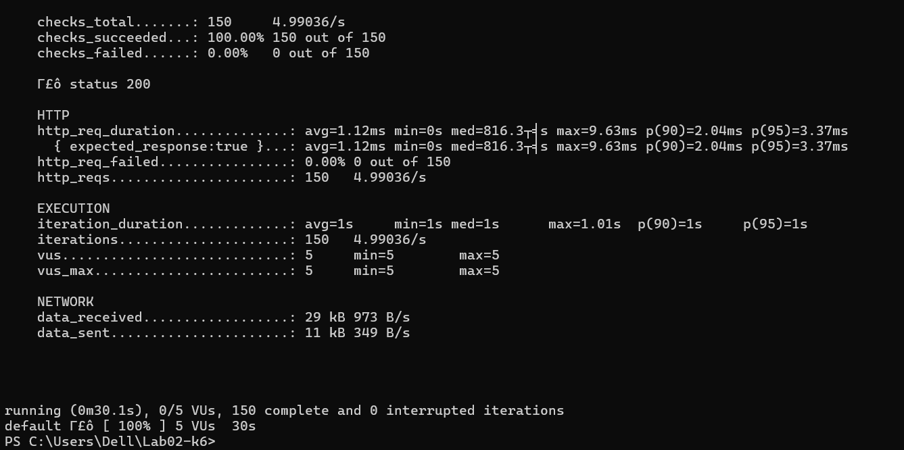
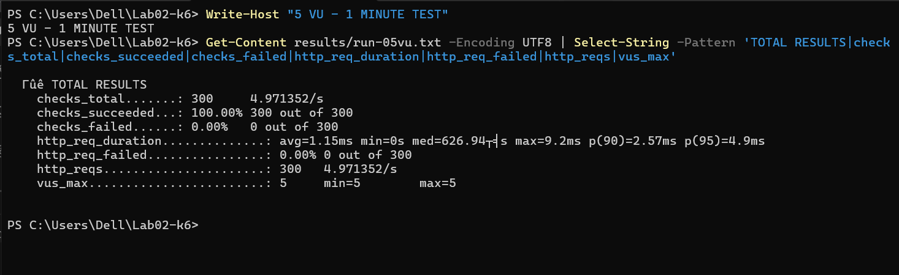
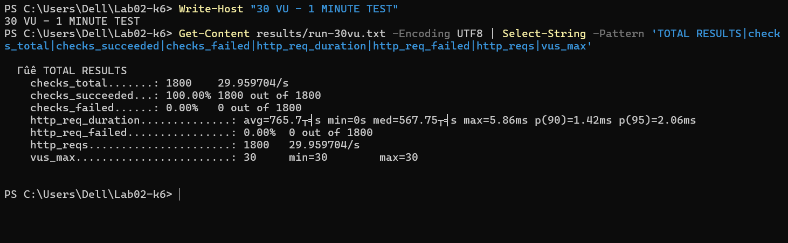
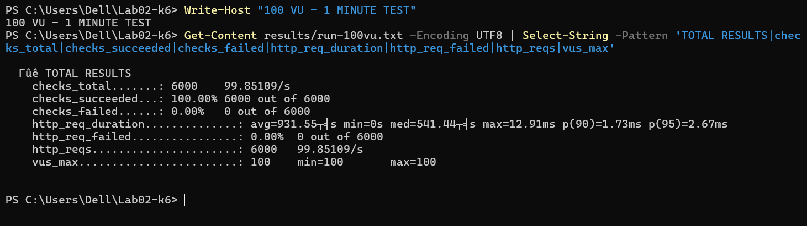
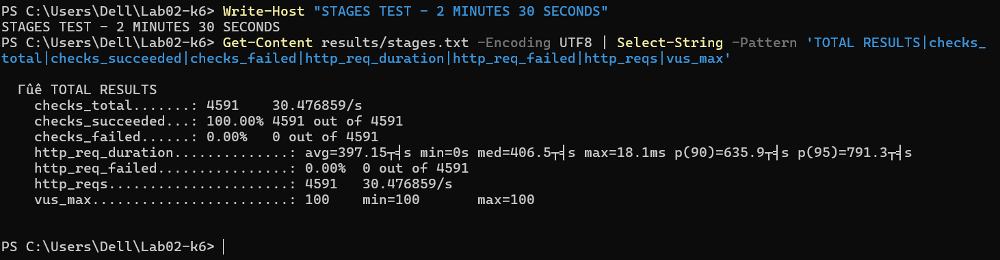
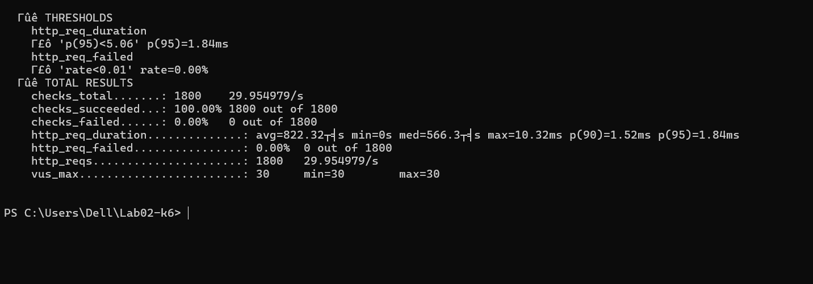
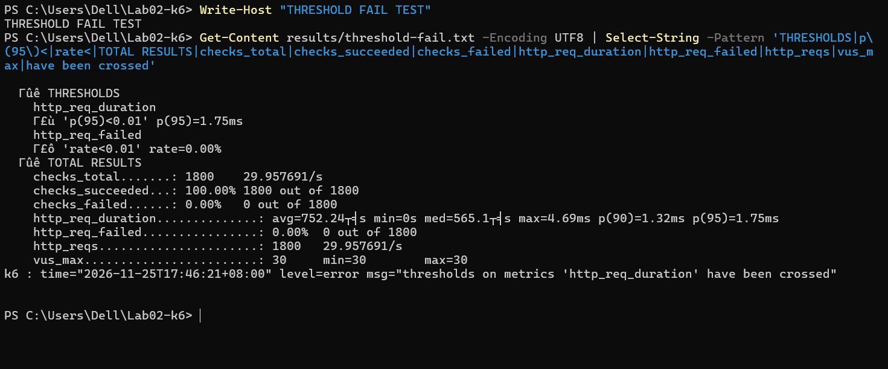
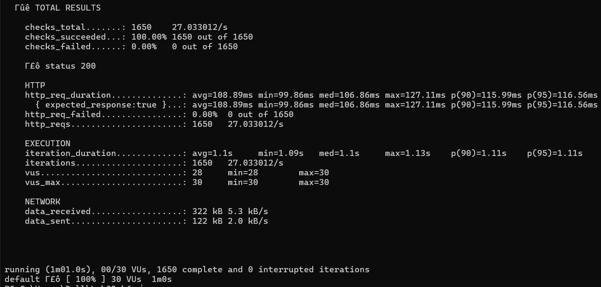

# Lab 02 — Гүйцэтгэлийн хэмжүүр (k6)

**Оюутны нэр:** С.Төгөлдөр  
**Оюутны код:** B232270801  
**Хичээл:** F.CSA313

## 1. Зорилго

k6 ашиглан системийн гүйцэтгэл, latency, throughput, error rate болон SLO шаардлагыг хэмжиж судлах.

## 2. Туршилтын орчин

- Үйлдлийн систем: Windows
- PowerShell: 5.1
- Node.js: v24.21.0
- k6: v2.4.0
- Сервер: http://127.0.0.1:3000

WSL суулгах үед 403 алдаа гарсан тул Windows дээр k6-г шууд суулгасан. Бүх тестийг өөрийн локал сервер дээр хийсэн.

## 3. Ажиллуулах заавар

Сервер асаах:

    node server.js

Өөр терминал дээр тестүүдийг ажиллуулах:

    k6 run script.js
    k6 run --vus 5 --duration 1m script.js
    k6 run --vus 30 --duration 1m script.js
    k6 run --vus 100 --duration 1m script.js
    k6 run stages.js
    k6 run threshold-pass.js
    k6 run threshold-fail.js
    k6 run slow-test.js

## 4. Baseline тест

- VU: 5
- Хугацаа: 30 секунд
- Нийт хүсэлт: 150
- p90: 2.04 ms
- p95: 3.37 ms
- Throughput: 4.99 req/s
- Error rate: 0%

[Бүрэн үр дүн](results/baseline-05vu.txt)

## 5. Ачааллын тестийн харьцуулалт

| VU | Хугацаа | p90 (ms) | p95 (ms) | Throughput (req/s) | Error rate | Нийт хүсэлт |
|---|---|---:|---:|---:|---:|---:|
| 5 | 60s | 2.57 | 4.90 | 4.97 | 0% | 300 |
| 30 | 60s | 1.42 | 2.06 | 29.96 | 0% | 1800 |
| 100 | 60s | 1.73 | 2.67 | 99.85 | 0% | 6000 |

### 5 VU

[Бүрэн үр дүн](results/run-05vu.txt)

### 30 VU

[Бүрэн үр дүн](results/run-30vu.txt)

### 100 VU

[Бүрэн үр дүн](results/run-100vu.txt)

## 6. Stages тест

| Үе шат | Хугацаа | Зорилтот VU |
|---|---|---:|
| 1 | 30s | 5 |
| 2 | 60s | 30 |
| 3 | 30s | 100 |
| 4 | 30s | 0 |

- Нийт хугацаа: 150 секунд
- Нийт хүсэлт: 4591
- p90: 0.6359 ms
- p95: 0.7913 ms
- Throughput: 30.48 req/s
- Error rate: 0%

Stages тест нь өөрчлөгдөх ачааллын нэгдсэн хэмжилт учраас тогтмол VU тестээс тусад нь авч үзсэн.

[Бүрэн үр дүн](results/stages.txt)

## 7. SLO тодорхойлох

Baseline p95 = 3.37 ms.

SLO = 3.37 x 1.5 = 5.055 ms буюу 5.06 ms.

Baseline хэмжилтээс 50 хувийн нөөцтэй байхаар p95-ийн шаардлагыг тодорхойлсон. HTTP хүсэлтийн алдааны хувь 1 хувиас бага байхаар тогтоосон.

- p95 < 5.06 ms
- Error rate < 1%

## 8. Threshold PASS болон FAIL

Хоёр тестийг 30 VU, 60 секундийн ижил нөхцөлөөр ажиллуулсан.

| Үзүүлэлт | PASS | FAIL |
|---|---:|---:|
| p95 шаардлага | 5.06 ms | 0.01 ms |
| Бодит p95 | 1.84 ms | 1.75 ms |
| p90 | 1.52 ms | 1.32 ms |
| Throughput | 29.95 req/s | 29.96 req/s |
| Error rate | 0% | 0% |
| Нийт хүсэлт | 1800 | 1800 |
| Үр дүн | PASS | FAIL |

FAIL тестэд p95-ийн шаардлагыг зориудаар 0.01 ms болгож чангаруулсан. HTTP хүсэлтүүд амжилттай байсан боловч latency threshold хангагдаагүй.

### Threshold PASS

[Бүрэн үр дүн](results/threshold-pass.txt)

### Threshold FAIL

[Бүрэн үр дүн](results/threshold-fail.txt)

## 9. Нэмэлт туршилт

Локал серверийн /slow endpoint-д 100 ms зориудын саатал нэмсэн.

| Үзүүлэлт | Энгийн endpoint | Slow endpoint |
|---|---:|---:|
| VU | 30 | 30 |
| Хугацаа | 60s | 60s |
| p90 | 1.42 ms | 115.99 ms |
| p95 | 2.06 ms | 116.56 ms |
| Throughput | 29.96 req/s | 27.03 req/s |
| Нийт хүсэлт | 1800 | 1650 |
| Error rate | 0% | 0% |

p95 ойролцоогоор 56.58 дахин өсөж, throughput 9.77 хувиар буурсан.

[Бүрэн үр дүн](results/slow-test.txt)

## 10. Дүгнэлт

1. Энэхүү лабораторийн ажлаар k6 ашиглан локал HTTP серверийн гүйцэтгэлийг хэмжсэн.
2. Baseline тестээр p95 хариу өгөх хугацаа 3.37 ms гарсан.
3. Виртуал хэрэглэгчийн тоог 5-аас 100 хүртэл нэмэгдүүлэхэд throughput 4.97-оос 99.85 req/s болж өссөн.
4. 30 VU-ээс 100 VU хүртэл ачаалал нэмэгдэхэд p95 нь 2.06 ms-ээс 2.67 ms болж өссөн.
5. Туршсан ачааллын хүрээнд HTTP алдаа гараагүй бөгөөд системийн хүчин чадлын дээд хязгаар тогтоогдоогүй.
6. Stages тестээр ачааллыг шатлан өөрчилж нийт 4591 хүсэлтийг амжилттай боловсруулсан.
7. Baseline хэмжилтэд үндэслэн p95-ийн SLO-г 5.06 ms, алдааны хувийг 1 хувиас бага байхаар тогтоосон.
8. Threshold PASS тестийн p95 нь 1.84 ms гарч SLO шаардлагыг хангасан.
9. Threshold FAIL тестээр HTTP хүсэлт амжилттай байх нь гүйцэтгэлийн шаардлага хангасан гэсэн үг биш болохыг баталсан.
10. Удаашралтай endpoint-ийн туршилтаар latency өсөхөд throughput буурч байгааг ажигласан бөгөөд үр дүн нь туршсан локал орчинд хамаарна.

## 11. Нэмэлт мэдээлэл

results/30vu.txt болон results/100vu.txt нь урьдчилсан 30 секундийн хэмжилтүүд бөгөөд үндсэн 60 секундийн харьцуулалтад ашиглаагүй.

Зарим үр дүнгийн файлд encoding-оос шалтгаалсан тусгай тэмдэгтийн дүрслэлийн алдаа байгаа боловч тоон хэмжилтүүд хадгалагдсан.
